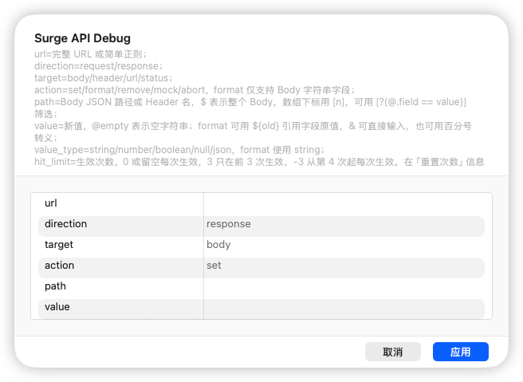
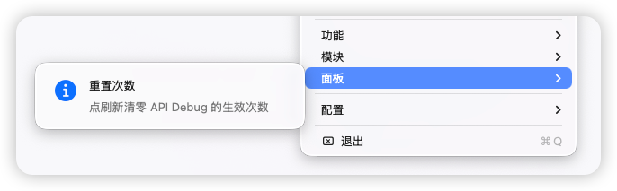

# Surge API Debug

在 Surge 中修改 HTTP 请求和响应，模拟接口异常，并控制故障生效几次。通过 Module 参数选择要调试的接口，无需修改 JavaScript。

完整使用指南见 [guide.html](guide.html)。clone 或下载后，用浏览器直接打开该文件即可；样式全部内嵌，可单独拷贝阅读，无需启动服务。

## 安装

正式版本从 `1.0.0` 开始，包含多模块隔离、独立重置面板、次数进度和调试日志。

复制以下地址，在 Surge 的「模块」中选择从 URL 安装。这个地址始终指向最新的正式 Release。

```text
https://github.com/evenlinyf/surge-api-debug/releases/latest/download/surge_api_debug.sgmodule
```

要锁定在 1.0.0，复制下面的固定版地址安装。

```text
https://github.com/evenlinyf/surge-api-debug/releases/download/v1.0.0/surge_api_debug.sgmodule
```

调试 HTTPS 时，在 Surge 中启用 MITM，并把目标域名加入 MITM 主机名列表。测试设备需要信任 Surge 的 MITM 证书。[Surge HTTP 处理文档](https://manual.nssurge.com/http/overview.html)

如果还不知道接口 URL 或要改的 JSON 字段，先看[用 Surge Mac 给 iPhone 或 Android 抓包](CAPTURE_GUIDE.md)。

安装后，在模块的参数配置中填写接口匹配规则和修改内容。



## 快速示例

让测试接口的第一次符合条件的响应返回 HTTP 500。把示例域名替换成自己的测试接口。

```text
url=^https://api\.example\.com/v1/profile$
direction=response
target=status
action=set
path=$
value=500
value_type=number
hit_limit=1
delay_ms=0
```

这条规则只改 HTTP 状态码。若要模拟整段响应内容，可以用 `target=body` 替换响应 Body，或在请求阶段用 `action=mock` 直接返回 HTTP 200。

## 参数

| 参数 | 用法 |
| --- | --- |
| `url` | 匹配完整请求 URL 的正则。可用 `^` 和 `$` 限定起止，用 `\.` 匹配字面量的点。 |
| `direction` | `request` 处理请求，`response` 处理响应。默认 `response`。 |
| `target` | `body`、`header`、`url` 或 `status`。默认 `body`。 |
| `action` | `set` 写入，`format` 格式化，`remove` 删除，`mock` 模拟响应，`abort` 中断。默认 `set`。 |
| `path` | Body 的 JSON 路径或 Header 名。`path=$` 代表整个 Body，或在不需要路径时用作占位。 |
| `value` | 写入的值。`@empty` 表示空字符串。`&` 可直接填写，也可以写成 `%26`。删除或中断等操作可填 `ignored`。 |
| `value_type` | `string`、`number`、`boolean`、`null` 或 `json`。默认 `string`。用于 Body 写入和 Mock。 |
| `hit_limit` | `0` 或留空表示每次生效。正数 `N` 只在前 `N` 次命中时生效，负数 `-N` 跳过前 `N` 次，从第 `N+1` 次起持续生效。 |
| `delay_ms` | 仅在操作应用时增加延迟，范围为 0 至 25000 毫秒。未命中、配置错误和次数跳过时不延迟。默认 0。 |

| 操作 | 可用方向 | 可用目标 |
| --- | --- | --- |
| `set` | 请求或响应 | `body`、`header` |
| `set` | 仅请求 | `url` |
| `set` | 仅响应 | `status` |
| `format` | 请求或响应 | `body` 中已有的字符串字段 |
| `remove` | 请求或响应 | `body` 中的字段或数组元素、`header` |
| `mock` | 仅请求 | 任意，直接返回 HTTP 200 |
| `abort` | 请求或响应 | 任意，中断连接 |

## Body 和筛选示例

保留前面的 `url` 和 `direction=response`，根据需要填写下面的字段。可以把 `hit_limit` 改成 `0`，让操作在每次命中时生效。

**把 JSON 字段设为空字符串**

```text
target=body
action=set
path=data.version
value=@empty
value_type=string
```

**筛选数组元素，并给每条匹配的字符串加前缀**

```text
target=body
action=format
path=data.items[?(@.id == 42 && @.role == 'member')].content
value=[调试]${old}
value_type=string
```

`${old}` 表示当前字段的原值。数组下标用 `[0]` 这样的形式，越界时保持原样。每条路径支持一个筛选器，后面需要跟目标字段。筛选可使用比较运算符、`&&`、`||` 和括号，所有可修改的匹配项都会处理。完全未命中时请求或响应保持原样。

**替换整个响应 Body**

```text
target=body
action=set
path=$
value={"code":0,"data":[]}
value_type=json
```

## 生效次数与重置

URL 命中且操作条件满足时才计数。同一请求修改多个数组元素也只算一次。同一条 URL 正则匹配的不同请求共用限额，请求方向和响应方向各自计数。

每个完整 URL 正则与方向的组合分别保存计数。换成尚未使用的 URL 正则时从头计数，切回之前的正则会继续使用它的计数。修改非零限额后，该规则下一次符合条件的请求从头计数。

要重新使用同一个限额，打开 Surge 的「重置次数」信息面板，点击刷新图标 **⟳**。显示「已清零，下次命中从头计数」后，下一次命中会从第 1 次开始。`hit_limit` 保持原值。Mac 从 Surge 菜单栏的「面板」进入，iOS 在策略选择页查看。[Surge 信息面板文档](https://manual.nssurge.com/tools/panel.html#dynamic-mode)

面板标题会显示配置的 `hit_limit`（例如 `重置次数 · hit_limit=3`），正文注明 URL 正则、`request` / `response` 方向及次数含义：正数为前 N 次生效，负数为跳过前 N 次，`0` 或留空为不限次数。

面板还会只读显示当前进度：正数为“已生效 2 次，剩余 1 次”，负数为“已跳过 2/3 次”或“已进入持续生效阶段”，不限次数时明确显示“不记录次数”。

修改非零限额后，面板会显示新序列的零进度，实际计数在下一次符合条件的请求时开始。点击刷新只清零该组合的计数，不影响其他接口或另一个方向。自动刷新不消耗次数、不清零。存储不可用或计数损坏时显示错误，不会假装次数为零；损坏状态可点刷新清零恢复。



如果面板不可用，可将 `hit_limit` 改为 `0`，发一条符合条件的请求，再改回原值。这条用于清零的请求也会执行操作。Surge 的计数读写没有原子操作，同时命中时实际次数可能与限额有出入。[Surge 持久化 API](https://manual.nssurge.com/scripting/api.html#persistentstore)

## 多个模块修改不同接口

模块在 Surge 中归入 `Dev` 分类。

可以多次安装同一份 Module，分别修改不同接口，共用一份 JS。给安装链接添加不同的查询参数即可创建独立实例，例如：

```text
https://github.com/evenlinyf/surge-api-debug/releases/latest/download/surge_api_debug.sgmodule?name=login
https://github.com/evenlinyf/surge-api-debug/releases/latest/download/surge_api_debug.sgmodule?name=messages
```

`?name=...` 只用于区分安装链接，不会传入模块配置，也不会更改显示名称。安装后分别填写各自的接口 URL 和修改参数，不需要增加名称属性：

| 参数 | 登录接口模块 | 消息接口模块 |
| --- | --- | --- |
| `url` | `^https://api\.example\.com/v1/login$` | `^https://api\.example\.com/v1/messages$` |
| `direction` | `response` | `response` |
| `target` | `body` | `body` |
| `action` | `set` | `set` |
| `path` | `data.version` | `data.message` |
| `value` | `@empty` | `调试消息` |
| `value_type` | `string` | `string` |
| `hit_limit` | `1` | `3` |
| `delay_ms` | `0` | `0` |

面板标识根据 URL 正则、方向和 `hit_limit` 自动生成；固定名称的 reset 脚本通过当前面板标识读取重置属性，不再依赖同名脚本实例传入的另一份配置，无需手填模块名称。修改配置后会生成相应的新面板标识，点击前请核对显示的接口和次数。升级时请将各实例的 Module 和 JS 一起更新。

两个模块可以同时启用，各自计数，各自重置。判断计数是否共用的依据是配置中的完整 `url` 正则和方向，与安装链接的 `name` 无关。若两份配置的 URL 正则和方向相同，则共用计数和重置范围。

每行脚本日志也会标明方向和完整 URL 正则，便于区分不同接口；重置日志使用该面板配置的方向与正则。例如：

```text
[Surge API Debug][response][^https://api\.example\.com/v1/login$] [状态] hit 1/1 applied
[Surge API Debug][response][^https://api\.example\.com/v1/messages$] [状态] hit 1/3 applied
```

日志会使用 `[已应用]`、`[已跳过]`、`[配置错误]`、`[执行错误]` 和 `[状态]` 标记结果。数组筛选会报告 `matched/changed/skipped` 数量及跳过原因；次数用尽会报告剩余次数，参数类型错误会附上配置示例。若脚本没有收到 URL 正则，日志会显示 `unconfigured`。

每份模块仍只有一组 `path` 和 `value`。本功能用于不同接口；同一方向只执行第一个匹配的 HTTP 脚本，多个正则不要重叠，不能依靠多份模块同时修改同一接口的不同字段。[Surge HTTP 脚本说明](https://manual.nssurge.com/scripting/http-request.html)

## 排查

`value` 中的合法百分号转义只解码一次，可与普通百分号混用，例如 `100% ready A%26B` 得到 `100% ready A&B`。要保留字面量 `%26`，写 `%2526`；无效 UTF-8 转义片段保持原样。`path` 和 URL 正则不会随 `value` 解码，筛选中的引号、`&` 和 `%` 按原值匹配。

- 完全没有触发时，确认 Module 已启用、URL 和方向正确。HTTPS 还要检查 MITM。同一方向只会运行第一个匹配的脚本。
- 已触发但没改动时，查看请求的 Notes，确认 JSON 路径命中、字段类型正确、次数还有剩余。Module 的 Body 大小上限为 4 MiB。
- 日志出现 `version mismatch` 时，重新导入与 JS 版本配套的 Module。固定安装链接同时锁定 Module 和 JS 的版本。

## 本地测试

使用 Node.js 22 或更新版本。单元测试模拟 Surge 的脚本环境，无需安装依赖或访问网络。本机若安装了 Surge CLI，还会自动执行双模块配置的原生语法检查；未安装时只跳过这项原生检查。也可用环境变量 `SURGE_CLI` 指定 CLI 路径。

```sh
node --test tests/*.test.js
node --test scripts/coverage-api-debug.js
```

测试覆盖 Body 和 Header、URL 与状态码、Mock 与 Abort、筛选、次数和重置面板，以及多个模块交替命中、计数隔离和单独重置。覆盖率命令用 V8 统计脚本的执行区间，最低要求为 95%。

## 发布新版本

同步更新 Module 和 JS 的版本号，让 Module 的两个脚本入口指向新标签下的 JS，提交并推送到 `main`。然后在 GitHub 仓库打开 **Actions → Publish release → Run workflow**，选择 `main` 并运行。

工作流会自动完成：

1. 从 JS 读取版本，检查脚本头、Module 说明、两个脚本地址及 `module_version` 是否一致。
2. 运行全部测试和最低 95% 的覆盖率检查。GitHub Linux runner 没有 Surge CLI，会跳过原生配置检查；该项仍需在安装了 Surge 的本机运行。
3. 按源码版本创建 `vX.Y.Z` tag，指向本次通过测试的提交；已有 tag 必须指向同一提交。
4. 创建正式 Release，生成发布说明，上传同名 `surge_api_debug.sgmodule` 附件，并设为最新版。JS 通过相同 tag 下的源码地址提供。
5. 下载发布的 Module 和固定版本 JS，与本次源码逐一比对。

也可以自行创建并推送 `vX.Y.Z` tag 触发同一流程；tag 必须与源码版本一致。普通代码推送不会自动发布。已经存在的 Release 不会被覆盖，重复运行会报错；发布后验证失败时先检查已生成的 Release，不要直接重复发布。

工作流使用仓库自带的 `GITHUB_TOKEN`，仅发布任务申请 `contents: write`，不需要添加个人令牌；仓库或组织策略需允许 Actions 创建 Release。手动运行按钮需要工作流先推送到默认分支。

发布前可在本机检查版本配对：

```sh
node scripts/check-release.js
# 手动打 tag 时，还可验证指定 tag 与源码一致：
node scripts/check-release.js v1.0.0
```

最新版安装地址保持不变。[GitHub Release 链接说明](https://docs.github.com/en/repositories/releasing-projects-on-github/linking-to-releases)

本项目使用 [MIT 许可证](LICENSE)。
